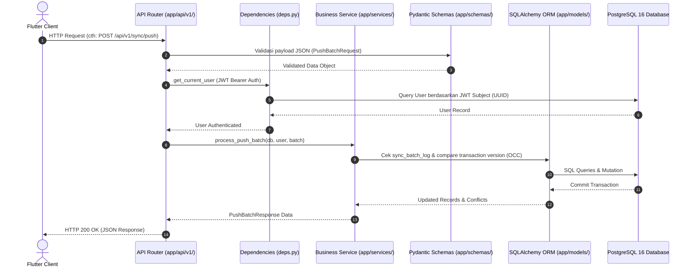

# Dokumentasi Struktur Direktori & Arsitektur Backend

Dokumen ini menjelaskan struktur direktori, fungsi setiap folder, modul, dan file di dalam direktori `backend/` pada proyek **Finance Tracker (Offline-First)**.

---

## 1. Peta Pohon Direktori

```text
backend/
├── alembic/                         # Manajemen migrasi skema database PostgreSQL
│   ├── versions/                    # Arsip file revisi migrasi (DDL)
│   │   └── 0001_initial_tables.py   # Migrasi inisial tabel users, transactions, dll.
│   ├── env.py                       # Konfigurasi runtime Alembic & koneksi ORM
│   └── script.py.mako               # Template boilerplate untuk generate revisi baru
├── app/                             # Kode utama aplikasi FastAPI
│   ├── api/                         # Layer HTTP Routing & Controller
│   │   ├── v1/                      # Versi API v1
│   │   │   ├── endpoints/           # Endpoint per domain fitur
│   │   │   │   ├── auth.py          # Handler register, login, refresh, me
│   │   │   │   └── sync.py          # Handler push, pull, resolve-conflict
│   │   │   └── api.py               # Aggregator router v1 (/api/v1)
│   │   └── deps.py                  # Dependency Injection (DB session & JWT auth)
│   ├── core/                        # Konfigurasi sentral & keamanan sistem
│   │   ├── config.py                # Pydantic Settings (Environment variables)
│   │   └── security.py              # Hash password, JWT encode/decode, token rotation
│   ├── db/                          # Konfigurasi koneksi & engine database
│   │   ├── base.py                  # DeclarativeBase SQLAlchemy
│   │   └── session.py               # Engine SQLAlchemy & SessionLocal generator
│   ├── models/                      # ORM Data Models (SQLAlchemy Entity)
│   │   ├── __init__.py              # Export model agar terbaca metadata Alembic
│   │   ├── user.py                  # Model User & RefreshToken
│   │   ├── transaction.py           # Model Transaction (Rupiah BigInt, UUID, Version)
│   │   └── sync_log.py              # Model SyncBatchLog (Idempotency Audit)
│   ├── schemas/                     # DTO / Pydantic Schemas (Validasi Request & Response)
│   │   ├── auth.py                  # Schema Register, Login, Token, Error
│   │   ├── transaction.py           # Schema TransactionRecord & TransactionType
│   │   └── sync.py                  # Schema PushItem, BatchRequest, PullResponse, Conflict
│   ├── services/                    # Business Logic Layer (Logika Inti Aplikasi)
│   │   ├── auth_service.py          # Registrasi, verifikasi password, rotasi token
│   │   └── sync_service.py          # Algoritma OCC push, cursor pull, deteksi & resolusi konflik
│   ├── __init__.py
│   └── main.py                      # FastAPI Application Instance & Root Middleware
├── .dockerignore                    # Pola file/folder yang dikecualikan dari Docker build
├── .env.example                     # Template variabel lingkungan untuk development
├── .gitignore                       # Pola file/folder yang dikecualikan dari Git
├── alembic.ini                      # Konfigurasi CLI dan path untuk Alembic
├── docker-compose.yml               # Orkestrasi multi-kontainer (FastAPI, PostgreSQL, pgAdmin)
├── Dockerfile                       # Resep image kontainer backend (Python 3.12-slim)
├── entrypoint.sh                    # Skrip inisialisasi kontainer (wait-for-db & auto-migrate)
├── README.md                        # Panduan ringkas setup & instruksi menjalankan backend
├── requirements.txt                 # Dependensi pustaka Python
└── test_api.py                      # Skrip automated end-to-end integration test
```

---

## 2. Penjelasan Detail Setiap Folder

### 📁 `backend/alembic/`
Folder ini dikelola oleh library **Alembic**, yaitu tool migrasi database bawaan ekosistem SQLAlchemy. Berfungsi untuk melacak evolusi skema tabel database PostgreSQL seiring waktu secara terkontrol dan aman (*version-controlled DDL*).
* **`versions/`:** Menyimpan riwayat file migrasi. Setiap perubahan struktur database (buat tabel, tambah kolom, buat index) dicatat dalam satu file bertanggal/berevisi di folder ini (contoh: `0001_initial_tables.py`).
* **`env.py`:** Skrip yang dieksekusi saat perintah `alembic upgrade` dijalankan. Skrip ini mengimpor `Base.metadata` dari SQLAlchemy models dan URL koneksi database dari konfigurasi aplikasi.
* **`script.py.mako`:** Template dasar berbasis Mako yang digunakan saat menghasilkan file revisi migrasi baru (`alembic revision --autogenerate`).

---

### 📁 `backend/app/`
Folder induk dari seluruh kode aplikasi Python (*application package*). Mengadopsi prinsip **Layered Architecture** untuk memisahkan tanggung jawab antara routing HTTP, validasi data, logika bisnis, dan interaksi database.

#### 📂 `backend/app/api/`
Bertanggung jawab atas **HTTP Interface / Controller Layer**.
* Mengatur routing request masuk dari client Flutter dan mengembalikan JSON response.
* **`v1/endpoints/`:** Modul controller domain spesifik:
  * `auth.py`: Endpoint registrasi (`/register`), login (`/login`), rotasi refresh token (`/refresh`), dan profil pengguna aktif (`/me`).
  * `sync.py`: Endpoint sinkronisasi offline-first, meliputi batch push (`/push`), query perubahan remote (`/pull`), dan penyelesaian konflik manual (`/resolve-conflict`).
* **`v1/api.py`:** Menghubungkan router-router endpoint menjadi satu router utama dengan prefix `/api/v1`.
* **`deps.py`:** Menyediakan fungsi *Dependency Injection* FastAPI:
  * `get_db`: Menyediakan sesi database SQLAlchemy per HTTP request yang ditutup secara otomatis setelah request selesai.
  * `get_current_user`: Membaca header `Authorization: Bearer <JWT>`, memvalidasi masa aktif token, dan mengambil objek user terkait dari database.

#### 📂 `backend/app/core/`
Menyimpan konfigurasi dasar dan utilitas keamanan sistem yang bersifat global.
* **`config.py`:** Menggunakan `pydantic-settings` untuk memuat variabel lingkungan dari file `.env` (seperti `DATABASE_URL`, `SECRET_KEY`, masa aktif token JWT, dan nama proyek) dengan validasi tipe data otomatis.
* **`security.py`:** Modul kriptografi untuk *password hashing* menggunakan algoritma modern (Bcrypt/Argon2id), pembuatan Access Token JWT (30 menit), Refresh Token (60 hari), enkripsi hash token session, serta decoding JWT.

#### 📂 `backend/app/db/`
Mengelola konektivitas fisik ke server PostgreSQL.
* **`base.py`:** Mendeklarasikan class `Base(DeclarativeBase)` yang menjadi fondasi seluruh model ORM SQLAlchemy.
* **`session.py`:** Menginisialisasi `engine` SQLAlchemy dengan koneksi pool yang andal (`pool_pre_ping=True`) serta membuat generator `SessionLocal` untuk transaksi database.

#### 📂 `backend/app/models/`
Lapisan **Data Layer / ORM Entity** yang merepresentasikan tabel riil di PostgreSQL.
* **`user.py`:**
  * Tabel `users`: Menyimpan `id` (UUID), `email` unik, `hashed_password`, dan timestamp.
  * Tabel `refresh_tokens`: Menyimpan hash refresh token yang terikat ke user untuk mendukung *Refresh Token Rotation* dan pencabutan sesi (*revocation*).
* **`transaction.py`:**
  * Tabel `transactions`: Menyimpan data transaksi finansial dengan nominal `BIGINT` (Rupiah murni), tipe transaksi (`income`/`expense`), kategori, tanggal kalender, soft-delete tombstone (`deleted_at`), nomor versi (`version` untuk OCC), dan indeks majemuk `(user_id, updated_at)` serta `(user_id, date)`.
* **`sync_log.py`:**
  * Tabel `sync_batch_log`: Mencatat `batch_id` yang dikirim client saat push untuk menjamin sifat **idempoten** (mencegah duplikasi data jika client mengalami kendala jaringan saat pengiriman).
* **`__init__.py`:** Mengimpor seluruh model ke satu pintu agar metadata skema dapat dikenali otomatis oleh Alembic.

#### 📂 `backend/app/schemas/`
Lapisan **Data Transfer Object (DTO)** berbasis Pydantic v2. Berfungsi memvalidasi struktur data payload yang dikirim oleh client sebelum diproses server, serta memformat data keluaran JSON.
* **`auth.py`:** Schema untuk `RegisterRequest`, `LoginRequest`, `TokenResponse`, `UserResponse`, dan `ErrorResponse`.
* **`transaction.py`:** Schema `TransactionRecord` dan enum `TransactionType`.
* **`sync.py`:** Schema outbox sync: `PushItem`, `PushBatchRequest`, `PushAppliedItem`, `PushConflictItem`, `PushBatchResponse`, `PullResponse`, dan `ResolveConflictRequest`.

#### 📂 `backend/app/services/`
Lapisan **Business Logic Layer**. Memisahkan aturan bisnis dari HTTP router agar kode mudah diuji (*unit test*) dan dipelihara.
* **`auth_service.py`:** Logika verifikasi pendaftaran email unik, pencocokan password terenkripsi, penerbitan token JWT, validasi token refresh, dan rotasi token.
* **`sync_service.py`:** Otak dari engine sinkronisasi offline-first:
  * **Idempotency Check:** Memastikan batch yang sama tidak diproses dua kali.
  * **Optimistic Concurrency Control (OCC):** Membandingkan `base_version` client dengan `version` server saat update/delete. Jika tidak cocok, ditandai sebagai konflik beserta snapshot versi server saat ini.
  * **Cursor Pagination:** Query data transaksi yang berubah berdasarkan timestamp `updated_at > cursor` termasuk record bertanda tombstone.
  * **Conflict Resolution:** Menerapkan strategi resolusi konflik (`use_client` atau `use_server`).

#### 📄 `backend/app/main.py`
Titik awal (*entrypoint*) aplikasi FastAPI:
* Menginisialisasi objek `FastAPI`.
* Mendaftarkan middleware CORS agar Flutter Web, Desktop, dan Android Emulator dapat terhubung tanpa kendala CORS.
* Mendaftarkan custom exception handler agar seluruh error mengembalikan format standar `ErrorResponse` (`{"error_code": "...", "message": "..."}`).
* Menyediakan endpoint health check `GET /health`.
* Menghubungkan seluruh router API di bawah prefix `/api/v1`.

---

## 3. Penjelasan File Root & Konfigurasi DevOps

| File | Fungsi & Peran |
| :--- | :--- |
| **`Dockerfile`** | Petunjuk containerization berbasis `python:3.12-slim` untuk mengompilasi dependensi dan membungkus backend ke dalam image mandiri. |
| **`docker-compose.yml`** | Konfigurasi orkestrasi untuk menjalankan 3 container: API FastAPI, PostgreSQL 16 Alpine, dan GUI pgAdmin 4. |
| **`entrypoint.sh`** | Skrip shell yang dieksekusi pertama kali saat kontainer menyala: melakukan polling hingga PostgreSQL siap, menjalankan migrasi `alembic upgrade head`, lalu menjalankan Uvicorn server. |
| **`requirements.txt`** | Daftar dependensi pustaka Python seperti FastAPI, SQLAlchemy, Alembic, Pydantic, PyJWT, Passlib, dan Psycopg3. |
| **`alembic.ini`** | File konfigurasi global untuk migrasi database Alembic. |
| **`.env.example`** | Panduan template variabel lingkungan yang aman di-commit ke Git. |
| **`.env`** | Konfigurasi aktif lokal (di-ignore oleh Git untuk keamanan kredensial). |
| **`.dockerignore`** | Mengoptimalkan build Docker dengan mengecualikan file virtual environment, cache, dan riwayat git. |
| **`test_api.py`** | Skrip automated integration test yang menguji alur auth, push batch, idempotency, pull cursor, deteksi konflik, dan resolusi konflik secara end-to-end. |
| **`README.md`** | Dokumentasi panduan operasional cepat untuk menjalankan dan menguji backend. |

---

## 4. Diagram Alur Data (Request Lifecycle)


