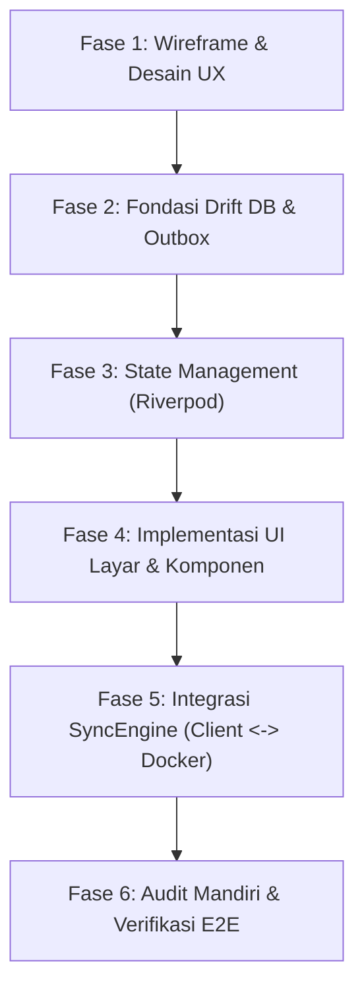

# Workplan Frontend & Offline-First Implementation (Flutter)

Dokumen ini memuat tahapan rencana kerja (*actionable workplan*) untuk pengembangan aplikasi mobile **Finance Tracker** berbasis Flutter, mulai dari perancangan wireframe, integrasi Drift database lokal, implementasi UI dengan standar antislop, hingga penyambungan ke backend FastAPI di Docker.

---

## Ringkasan Alur Kerja

---

## Rincian Tiap Fase

### Fase 1: Wireframe & Spesifikasi Alur UX
*Fokus: Mengunci layout dan interaksi sebelum menulis kode UI.*
1. **Design Tokens & Arah Visual:**
   - Palet warna fungsional (Income: Emerald/Teal, Expense: Coral/Rose, Pending: Slate/Abu, Conflict: Amber/Oranye).
   - Tipografi yang jelas dan hierarki angka moneter (tabular figures untuk nominal Rupiah).
2. **Wireframe Layar Utama (Home / Monthly Transactions):**
   - Header ringkasan: Total Pemasukan, Total Pengeluaran, Saldo Bersih bulan terpilih.
   - Month-Year Selector (navigasi cepat antar bulan tanpa bug pergeseran tanggal).
   - Indikator status jaringan (Banner halus saat offline atau sinkronisasi berlangsung).
   - Daftar transaksi per tanggal: Badge status per item (`pending`, `synced`, `conflict`), nominal uang, kategori, dan catatan.
3. **Wireframe Form Transaksi (Add/Edit):**
   - Input nominal Rupiah terformat real-time (`Rp 50.000`).
   - Pemilih tipe: Pemasukan vs Pengeluaran.
   - Pilihan kategori cepat (grid/chips) + input catatan opsional.
   - Date picker tanggal kalender lokal (`YYYY-MM-DD`).
4. **Wireframe Dialog Resolusi Konflik:**
   - Tampilan *side-by-side*: Versi Lokal vs Versi Server (menampilkan perbedaan nominal/kategori/catatan).
   - Tombol aksi jelas: *"Pakai Versi Lokal"* atau *"Pakai Versi Server"*.

---

### Fase 2: Fondasi Drift DB & Outbox (Local-First Engine)
*Fokus: Database SQLite lokal sebagai Single Source of Truth.*
1. **Setup Dependencies:**
   - Tambahkan `drift`, `drift_flutter`, `sqlite3_flutter_libs`, `uuid`, `path_provider`, `flutter_riverpod`, `dio`.
2. **Definisi Tabel Drift:**
   - `TransactionsTable`: `id` (UUID), `user_id`, `amount`, `type`, `category`, `note`, `date`, `version`, `sync_status`, `deleted_at`, `updated_at`.
   - `SyncOutboxTable`: `id`, `transaction_id`, `action`, `base_version`, `payload` (JSON), `status`, `created_at`.
   - `SyncStateTable`: `key`, `value` (cursor dan timestamp).
3. **Database Access Objects (DAOs):**
   - Transaksi CRUD lokal dengan pembaruan instan (*latency 0 ms*).
   - Soft delete (menulis `deleted_at` ke Drift dan mencatat mutasi `delete` di Outbox).
   - Query reaktif berbasis `Stream` (UI otomatis ter-update saat data lokal berubah).

---

### Fase 3: State Management & Repositori (Riverpod)
*Fokus: Memisahkan logika bisnis dari UI.*
1. **TransactionRepository:**
   - Mengelola penyimpanan lokal dan pengisian antrean outbox.
2. **MonthFilterNotifier:**
   - Mengatur state filter bulan aktif dan mengalirkan data transaksi bulan tersebut.
3. **AuthNotifier:**
   - Menyimpan JWT & Refresh token ke `flutter_secure_storage`.
   - Mengelola status login, logout, dan auto-login.
4. **NetworkStatusNotifier:**
   - Memantau status koneksi via `connectivity_plus`.

---

### Fase 4: Implementasi UI Layar & Komponen
*Fokus: Membangun widget Flutter yang bersih, responsif, dan bebas generic slop.*
1. **Layar Autentikasi:**
   - Halaman Login & Registrasi sederhana dan fungsional.
2. **Layar Utama (Home / Monthly View):**
   - Komponen Header Saldo.
   - Filter pemilih bulan yang intuitif.
   - Daftar transaksi dengan agrupasi tanggal lokal.
   - Status badge yang jelas untuk tiap transaksi (`pending`, `synced`, `conflict`).
   - Floating Action Button (FAB) untuk tambah transaksi baru.
3. **Layar Tambah / Edit Transaksi:**
   - Field nominal dengan formatting Rupiah otomatis tanpa desimal.
   - Chip selector kategori.
   - Validasi form yang ramah pengguna.
4. **Dialog Penyelesaian Konflik:**
   - Modal bottom sheet atau dialog perbandingan langsung jika ada item berstatus `conflict`.

---

### Fase 5: Integrasi SyncEngine (Client <-> Backend Docker)
*Fokus: Mengalirkan data antara Drift lokal dan FastAPI di Docker.*
1. **ApiClient (Dio):**
   - Konfigurasi base URL: `http://10.0.2.2:8000/api/v1` (Android Emulator) atau LAN IP.
   - Interceptor untuk menyisipkan Bearer token dan menangani auto-refresh token (401).
2. **SyncEngine Worker:**
   - Logika **Push**: Membaca outbox `pending` $\to$ kirim batch dengan `batch_id` $\to$ tandai `synced` atau `conflict`.
   - Logika **Pull**: Menarik delta sejak kursor terakhir $\to$ perbarui record Drift lokal.
   - Trigger otomatis: Saat aplikasi dibuka, saat koneksi internet pulih, dan setelah transaksi baru dibuat.

---

### Fase 6: Audit Mandiri & Verifikasi End-to-End (User Gate)
*Fokus: Verifikasi langsung oleh pengguna.*
1. **Pengujian Airplane Mode (Offline Penuh):**
   - Masuk mode pesawat $\to$ buat 3 transaksi $\to$ edit 1 transaksi $\to$ hapus 1 transaksi. Semua harus tampil seketika di UI lokal dengan badge `pending`.
2. **Pengujian Reconnect (Auto Sync):**
   - Matikan mode pesawat $\to$ aplikasi mendeteksi online $\to$ outbox terkirim ke backend Docker $\to$ semua badge berubah menjadi `synced`.
3. **Pengujian Skenario Konflik:**
   - Simulasikan perubahan dari perangkat lain / script API $\to$ lakukan edit di aplikasi dengan versi lama $\to$ verifikasi item berstatus `conflict` $\to$ selesaikan konflik lewat dialog UI.
4. **Verifikasi Performa:**
   - Uji kelancaran scrolling dan filtering daftar transaksi lokal.
